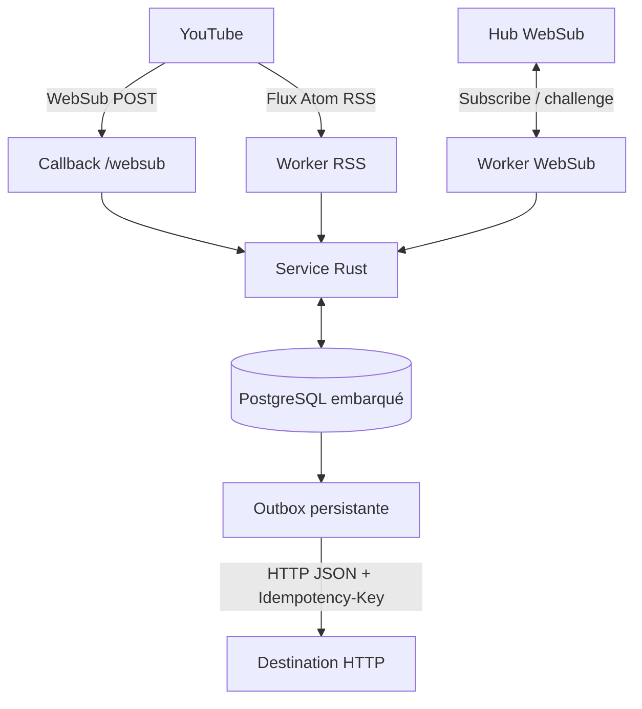

<!-- VoxyTube — near-real-time YouTube event delivery -->

<div align="center">

# VoxyTube

### YouTube uploads. Delivered to your webhook in seconds.

A lightweight, self-hosted Rust service that turns YouTube channel uploads into **near-instant HTTP events**. No polling-only workflow, no platform lock-in: receive a notification and forward it to any HTTP endpoint.

[**Documentation**](https://voxytube.gitbook.io) · [Installation](https://voxytube.gitbook.io) · [API reference](https://voxytube.gitbook.io) · [Report a bug](https://github.com/KuaFeur/Voxytube/issues)

[](https://github.com/KuaFeur/Voxytube/actions/workflows/ci.yml)
[](LICENSE)
[](https://www.rust-lang.org/)
[](https://github.com/KuaFeur/Voxytube/pkgs/container/voxytube)

</div>

---

## ⚡ Near-instant notifications, not slow polling

VoxyTube is built around **YouTube WebSub push notifications**. When YouTube publishes a new upload notification, WebSub pushes it to VoxyTube; the service can then deliver the event to your destination without waiting for the next RSS polling interval.

The result is a near-real-time workflow: **typically seconds after YouTube emits the notification**, rather than waiting minutes for a scheduled feed check.

RSS reconciliation runs as a safety net to catch updates that may have been missed. Actual delivery time still depends on when YouTube publishes the notification and on the availability and response time of your destination; no fixed end-to-end latency is guaranteed.

## What is VoxyTube?

VoxyTube is a self-hosted YouTube event gateway written in Rust. It watches configured YouTube channels, normalizes upload events and forwards them as JSON over HTTP.

It is **destination-agnostic**. Connect it to your own backend, automation workflow, notification service, community integration or any application that accepts HTTP requests.

## Highlights

| Feature | What it does |
| --- | --- |
| ⚡ **Near-real-time delivery** | WebSub push notifications avoid waiting for the next RSS polling cycle. |
| 🔁 **RSS reconciliation** | Periodic feed checks help recover notifications that were missed. |
| 💾 **Durable event storage** | PostgreSQL persistence, deduplication and a transactional outbox. |
| 🌐 **Any HTTP destination** | Sends normalized JSON to any compatible webhook endpoint. |
| 🔐 **Protected management API** | Bearer-token authentication for channel and event management. |
| ♻️ **Automatic retries** | Failed deliveries are retried; exhausted events can be inspected and requeued. |
| 📦 **Self-hosted** | Docker image and Pelican / Pterodactyl Egg available. |
| 🦀 **Rust** | Async, lightweight service built with the Rust ecosystem. |

## How it works



1. Register a YouTube channel through the management API.
2. VoxyTube requests a WebSub subscription for that channel.
3. YouTube pushes upload notifications to VoxyTube.
4. VoxyTube validates, deduplicates and persists each event.
5. The delivery worker forwards the normalized event to your webhook.
6. Failed deliveries are retried automatically; RSS reconciliation provides an additional safety net.

## Get started

### Pelican / Pterodactyl

The repository includes an Egg for deploying VoxyTube with its published container image.

1. Download and import [`egg-voxytube.json`](deploy/pelican/egg-voxytube.json) into your panel.
2. Create a server using the imported Egg and allocate the application port (default: `8080`).
3. Configure the required environment variables.
4. Make the WebSub callback reachable over HTTPS and route it to the server.
5. Keep `/home/container/data` on persistent storage.

**Container image**

```text
ghcr.io/kuafeur/voxytube:latest
```

### Required environment variables

| Variable | Description |
| --- | --- |
| `PUBLIC_CALLBACK_URL` | Public HTTPS callback URL, ending in `/websub`. |
| `API_TOKEN` | Management API Bearer token. Use at least 32 random characters. |
| `WEBHOOK_URL` | HTTP(S) endpoint that receives normalized event JSON. |
| `WEBHOOK_TOKEN` | Optional Bearer token sent to the destination. |

### Optional environment variables

| Variable | Default / description |
| --- | --- |
| `PORT` | HTTP listen port. Default: `8080`. |
| `POSTGRES_DB` | Embedded PostgreSQL database name. Default: `voxytube`. |
| `POSTGRES_USER` | Embedded PostgreSQL user. Default: `voxytube`. |
| `POSTGRES_PASSWORD` | If omitted, a random password is generated and persisted. |
| `POSTGRES_RESTORE_FILE` | Optional custom-format PostgreSQL dump to restore on startup. |
| `DATABASE_MAX_CONNECTIONS` | Maximum database connections. Default: `10`. |
| `RSS_INTERVAL_SECONDS` | RSS reconciliation interval. Default: `300`. |
| `WEBSUB_HUB_URL` | WebSub hub URL. |
| `RUST_LOG` | Rust tracing filter. |

Generate a management token:

```bash
openssl rand -hex 32
```

The PostgreSQL instance is internal. **Do not expose port `5432` publicly.** Persist `/home/container/data`: it contains the database and delivery history.

For Docker deployment, reverse-proxy configuration, backups and restore procedures, follow the **[official documentation](https://voxytube.gitbook.io)**.

## Management API

All management routes require a Bearer token:

```http
Authorization: Bearer <API_TOKEN>
```

| Method | Endpoint | Description |
| --- | --- | --- |
| `POST` | `/api/v1/channels` | Add a channel and request a WebSub subscription. |
| `GET` | `/api/v1/channels` | List configured channels and subscription states. |
| `DELETE` | `/api/v1/channels/{channel_id}` | Request an asynchronous unsubscribe. |
| `GET` | `/api/v1/events` | View event counts and recent deliveries. |
| `POST` | `/api/v1/events/{id}/retry` | Requeue a dead event. |
| `GET` | `/healthz` | Check database connectivity. |
| `GET` | `/readyz` | Check service readiness. |

The public WebSub callback is available at `GET /websub` and `POST /websub`.

### Add a channel

```bash
curl -X POST "https://your-host.example/api/v1/channels" \
  -H "Authorization: Bearer $API_TOKEN" \
  -H "Content-Type: application/json" \
  -d '{"channel_id":"UCxxxxxxxxxxxxxxxxxxxxxx"}'
```

A `202 Accepted` response means the subscription request was submitted; it does not mean YouTube has verified it yet. Check `GET /api/v1/channels` until the channel state is `active`.

## Event payload

VoxyTube forwards a normalized JSON event to the configured destination:

```json
{
  "event": "youtube.video.published",
  "video_id": "VIDEO_ID",
  "channel_id": "CHANNEL_ID",
  "channel_title": "Channel name",
  "title": "Video title",
  "url": "https://www.youtube.com/watch?v=VIDEO_ID",
  "published_at": "2026-11-13T10:00:00Z",
  "source": "websub"
}
```

Each delivery includes an idempotency header:

```http
Idempotency-Key: voxytube-<outbox-id>
```

### Delivery guarantees

Delivery is **at-least-once**, not exactly-once. A network timeout can occur after the destination has already processed a request. Receiving applications should store and honor the `Idempotency-Key` to prevent duplicate side effects.

Events are persisted before delivery. If `WEBHOOK_URL` is empty, delivery is disabled and events remain in the outbox until a destination is configured.

## Technology

- **Language:** Rust (edition 2024)
- **HTTP framework:** Axum
- **Database:** PostgreSQL
- **Notification transport:** YouTube WebSub
- **Fallback:** RSS reconciliation
- **Deployment:** Docker, Pelican and Pterodactyl

VoxyTube does not rely on YouTube page scraping, `yt-dlp` or a YouTube Data API key.

## Development

Requirements: Rust stable and PostgreSQL 14 or newer.

```bash
git clone https://github.com/KuaFeur/Voxytube.git
cd Voxytube
cp .env.example .env
```

Configure `DATABASE_URL`, `PUBLIC_CALLBACK_URL` and `API_TOKEN` in `.env`, then start the service:

```bash
cargo run
```

Run formatting, tests and lint checks:

```bash
cargo fmt --all -- --check
cargo test --all-targets
cargo clippy --all-targets -- -A warnings
```

## Documentation & resources

<div align="center">

## [📚 Read the VoxyTube documentation](https://voxytube.gitbook.io)

Installation · Configuration · API reference · Operations · Troubleshooting

</div>

- [Operations guide](docs/OPERATIONS.md)
- [Pelican Egg](deploy/pelican/egg-voxytube.json)
- [Releases](https://github.com/KuaFeur/Voxytube/releases)
- [Issues and bug reports](https://github.com/KuaFeur/Voxytube/issues)

## Project status

VoxyTube is under active development and validation. Review the release notes and documentation before deploying it in a critical environment. YouTube and WebSub behavior can change independently of this project.

## License

Licensed under the [Apache License 2.0](LICENSE).
